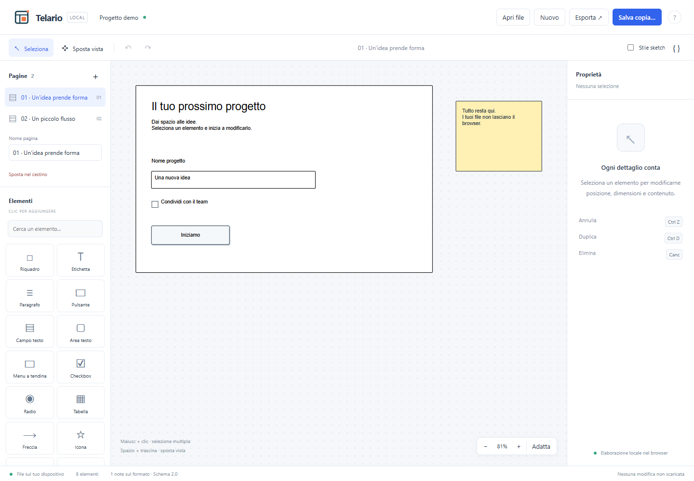

# Telario

Identità Telario e kit web/stampa: [galleria locale](assets/logos/index.html), [anteprima](assets/logos/preview.png), [guida ai formati](assets/logos/README.md). Logo scelto: Wireframe, petrolio e arancio. Tutte e quattro le [proposte originali](assets/proposte/index.html) e i relativi formati sono conservati e consultabili.

Editor web locale per file `.bmpr`: apre progetti SQLite, visualizza le pagine, modifica i wireframe ed esporta i risultati. React + TypeScript, Vite, sql.js/WebAssembly, SVG e rough.js. Docker serve l'app con Nginx; i documenti vengono elaborati esclusivamente nel browser.

**Stato: prima versione funzionante. Il salvataggio `.bmpr` è sperimentale, non ancora certificato mediante riapertura in Balsamiq.** Il download richiede un'attivazione esplicita nella finestra di salvataggio. Conservare gli originali.



Risultati e limiti delle prove eseguite: [VALIDAZIONE.md](VALIDAZIONE.md).

## Avvio sulla macchina di supporto

Occorrono Docker Engine / Docker Desktop e Docker Compose v2. Copiare il repository, incluso `package-lock.json`, oppure clonarlo quando sarà pubblicato. Non servono Node o Python sulla macchina di destinazione.

È disponibile anche `artifacts/telario-0.1.0.zip`: estrarlo in una cartella sulla macchina di supporto ed eseguire il comando seguente da quella cartella. Il pacchetto include sorgenti, configurazione e istruzioni, senza dipendenze installate o mockup privati. Per rigenerarlo: `python scripts/package-release.py`.

```sh
docker compose up --build -d
```

Aprire **http://localhost:8080** e scegliere **Esplora la demo** oppure **Apri file**. Il primo build scarica le immagini Docker e le dipendenze. Dopo il build, l'app non richiede servizi esterni, CDN o accesso a Internet per usare l'editor.

```sh
docker compose ps
docker compose logs --tail=100 editor
docker compose down
```

La porta è pubblicata solo su `127.0.0.1` per impostazione predefinita. Per accedervi da un altro PC della LAN, creare un file `.env` accanto a `compose.yaml`:

```dotenv
BMPR_BIND_ADDRESS=0.0.0.0
BMPR_PORT=8080
```

Aprire quindi `http://IP-DELLA-MACCHINA:8080`, consentendo la porta nel firewall. Non è presente autenticazione. Il container non riceve i mockup e non salva documenti: non occorrono volumi per i file utente. **Le modifiche non scaricate si perdono chiudendo o ricaricando la scheda.**

Healthcheck: `GET /health` restituisce `ok`. Il filesystem del container è in sola lettura, con directory temporanee per Nginx. Il Dockerfile esegue la build in Node e copia soltanto `dist` nell'immagine finale.

## Funzionalità

Icone: catalogo locale Font Awesome Free con alias storici; [copertura, licenze e sostituzioni](docs/ICONE.md).

- Apertura dal selettore file o tramite trascinamento; schemi osservati 1.2 e 2.0.
- Elenco pagine, rinomina, nuove pagine, cestino reversibile.
- Selezione singola, multipla con Maiusc e rettangolo di selezione; spostamento, otto maniglie di ridimensionamento, pannello proprietà, doppio clic per il testo.
- Copia/taglia/incolla interni all'editor, duplicazione, eliminazione, allineamento a sinistra/in alto, ordine di sovrapposizione, undo/redo fino a 100 operazioni.
- Zoom, adattamento pagina, spostamento vista, stile sketch opzionale.
- Libreria di elementi: riquadro, etichetta, paragrafo, campi, pulsanti, tabella, freccia, icona, finestre e nota.
- Rendering aggiuntivo di gruppi, pulsanti rotondi, tab, checkbox/radio in gruppo e altri controlli comuni. Immagini PNG/JPEG/GIF/WebP incorporate nel progetto. Catalogo vettoriale Font Awesome Free, alias storici e segnaposto per le icone sconosciute.
- Export della pagina in SVG e PNG; testi di tutte le pagine in Markdown; dati in JSON; diagrammi approssimati in Mermaid e draw.io.
- Download di una copia `.bmpr`, preservando risorse, tabelle e campi non modificati.
- Demo sintetica a due pagine, guida e ispezione JSON nell'app.

## Integrità e limiti

Il lettore conserva i byte originali e i JSON grezzi. Un salvataggio senza modifiche restituisce **gli stessi byte**. Con modifiche, il writer apre una copia in memoria, aggiorna soltanto le righe delle pagine modificate in una transazione, incrementa `ArchiveRevision`, aggiorna `ArchiveRevisionUUID` se presente e verifica `PRAGMA integrity_check`. Campi e controlli sconosciuti restano nel JSON. Le altre risorse, i commenti e le tabelle non vengono ricostruiti. Per aggiungere una pagina in uno schema con colonne obbligatorie sconosciute, il salvataggio fallisce senza toccare l'originale.

Limiti da conoscere:

- **Compatibilità Balsamiq ancora da verificare manualmente** su file salvati, pagine aggiunte e gruppi ridimensionati. I test di riapertura nell'editor non sostituiscono questa verifica.
- I file creati da zero/demo usano uno schema sintetico; non sono fixture esportate da Balsamiq.
- Le miniature incorporate vengono conservate, non rigenerate: in altri programmi potrebbero apparire vecchie.
- Curve delle frecce, formattazione del testo, tabelle, gruppi e diversi controlli sono resi in modo approssimato. I gruppi sono spostabili e ridimensionabili come blocchi; non è disponibile l'editing dei singoli figli dall'interfaccia.
- Simboli riutilizzabili, varianti e controlli avanzati non risolti appaiono come segnaposto. Tutti i dati restano nell'archivio. Le pagine dei diversi rami vengono elencate senza gestione dei rami.
- Font di sistema e grafica indipendente: il disegno non riproduce esattamente Balsamiq. Le risorse esterne, i link e gli SVG incorporati non vengono caricati/eseguiti.
- Mermaid/draw.io deducono i collegamenti dalla vicinanza degli estremi; vanno controllati, soprattutto su schermate UI.
- Limite di apertura 100 MB. Il database e la cronologia sono in memoria: file molto grandi possono essere lenti. Il PNG viene ridotto entro 8192 pixel per lato e circa 32 megapixel.
- Nessun autosalvataggio persistente, collaborazione online o sincronizzazione Dropbox. Dropbox serve solo come cartella da cui scegliere i file.

## Sviluppo e test senza Docker

Node 22 LTS e npm:

```sh
npm ci
npm run dev
npm test
npm run build
```

Per i test del browser:

```sh
npx playwright install chromium
npm run test:ui
```

Si può impostare `BMPR_TEST_BROWSER` al percorso di un Chromium già installato. Playwright avvia e arresta il server di test; gli artefatti sono ignorati da Git. Per il test sulla build compilata: `BMPR_TEST_PREVIEW=1 npm run test:ui` (PowerShell: `$env:BMPR_TEST_PREVIEW='1'; npm run test:ui`).

```sh
npm run fixtures
```

Genera cinque `.bmpr` sintetici in `tests/fixtures/generated/`, con SVG di riferimento prodotti da questo editor. **Non** sono confronti visivi con Balsamiq. La cartella è ignorata da Git.

Per la verifica opzionale di una raccolta privata, è necessario anche `rg` (ripgrep):

```powershell
$env:BMPR_SAMPLE_ROOT='D:/percorso/ai/mockup'
npm test -- tests/private-corpus.test.ts
```

Il test legge gli originali, salva e riapre copie **solo in memoria**, verifica la conservazione delle altre risorse e stampa soltanto conteggi anonimi. Non scrive file `.bmpr`, schermate o contenuti dei clienti. Per un inventario strutturale: `python scripts/inspect-format.py PERCORSO` (Python 3, libreria standard e `rg`).

Dopo `npm run build`, `node scripts/check-private-browser.mjs PERCORSO` prova alcuni archivi rappresentativi in Chromium, avviando temporaneamente la build locale sulla porta 4179. Non salva screenshot, tracce o contenuti dei file; stampa solo un riepilogo anonimo. Richiede Chromium installato da Playwright oppure `BMPR_TEST_BROWSER`.

## Prova manuale sulla macchina di supporto

Il confronto locale con i PNG esistenti è stato eseguito su 13 pagine, con correzioni al renderer e limiti documentati in [VALIDAZIONE.md](VALIDAZIONE.md). Per ripeterlo: `python scripts/discover-visual-pairs.py PERCORSO_ARCHIVI CARTELLA_TEMP_ESTERNA` (richiede Python, Pillow e `rg`), poi `node scripts/render-visual-pairs.mjs CARTELLA_TEMP_ESTERNA 0,1,2`. Il secondo comando richiede Chromium Playwright oppure `BMPR_TEST_BROWSER`. Entrambi rifiutano una cartella di destinazione interna al progetto. Il manifest contiene percorsi privati e le immagini contengono mockup reali: mantenerli nella cartella temporanea locale. Gli abbinamenti per nome sono candidati da verificare, perché il PNG può rappresentare una revisione diversa.

1. Avviare Docker, verificare che il servizio sia `healthy`, aprire la demo.
2. Verificare spostamento, testo, ridimensionamento, annulla/ripeti e gli export.
3. Aprire un `.bmpr` reale e confrontare le pagine con Balsamiq e i PNG originali.
4. Scaricare una copia senza modifiche e riaprirla in Balsamiq.
5. Modificare un testo e una posizione, scaricare una nuova copia, verificare in Balsamiq che le modifiche siano presenti e il resto invariato.
6. Ripetere con pagine aggiunte/eliminate/ripristinate, gruppi, immagini, frecce e controlli non gestiti.
7. Finché questi controlli non sono superati, mantenere il salvataggio come sperimentale e conservare gli originali.

## Struttura

```text
src/io/        lettura, salvataggio e demo SQLite
src/model/     dati grezzi, geometria e creazione controlli
src/render/    disegno SVG e stile sketch
src/editor/    cronologia undo/redo
src/export/    SVG, PNG, Markdown, JSON, Mermaid e draw.io
src/ui/        interfaccia e interazioni
tests/         test sintetici, test browser, verifica privata opzionale
scripts/       generazione esempi e analisi strutturale in sola lettura
```

Il progetto è indipendente e non affiliato a Balsamiq. Il nome definitivo è Telario; la licenza del progetto resta da decidere; non è stata attribuita una licenza senza una scelta del proprietario. Prima di pubblicare, verificare i termini applicabili e rimuovere eventuali riferimenti ai clienti dai documenti storici. Nessun mockup privato deve entrare nel repository o nell'immagine Docker. Le icone dell'interfaccia sono disegnate con geometrie originali; il progetto non include risorse grafiche o font proprietari di Balsamiq.

Le licenze delle librerie distribuite sono raccolte in `public/third-party-notices.txt`, incluso nella build. Dopo un aggiornamento delle dipendenze, rigenerarlo con `node scripts/generate-notices.mjs`.
